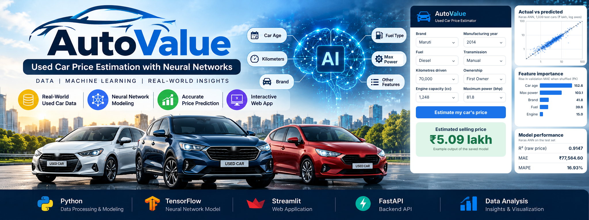

# AutoValue — Used Car Price Estimation with Neural Networks



AutoValue estimates the selling price of a used car in the Indian market from twelve vehicle details. A Keras neural network with a learned brand embedding produces the estimate, a FastAPI service serves the model, and a Streamlit interface lets a user enter a car and explore the result.

MSc Data Science · NNDL · Trimester 4 · CHRIST (Deemed to be University), Pune Lavasa Campus

## Problem statement and objectives

Used-car prices vary with age, usage and specifications, so buyers and sellers need a reasonable data-driven starting point. The course project required:

- a linear-regression baseline,
- a neural network with a learned brand embedding,
- a neural network implemented from scratch,
- experiment comparisons, and
- a working application.

Two numerical targets were set: a lower test MAE than linear regression, and a log-price R² of at least 0.85. Both were met (see [Evaluation](#evaluation)).

## Main features

- **Price estimate** in rupees and lakh from 12 inputs (brand, age, kilometres, mileage and unit, engine, power, seats, fuel, seller type, transmission, owner).
- **Model-uncertainty range** from 50 Monte Carlo dropout passes (5th–95th percentile). It is uncalibrated; see [Known limitations](#known-limitations).
- **What-if studio** to change age or kilometres while the other inputs stay fixed.
- **Model insights** tab showing permutation feature importance, with CSV download.
- **Input validation** in the API: missing or extra fields, invalid categories and out-of-range numbers are rejected with HTTP 422; unseen brands and out-of-training-range values return notes.
- **Prediction log** written to `logs/predictions.jsonl` (not committed).

## Technology stack

| Layer | Tools |
|---|---|
| Model | TensorFlow / Keras 2.20, scikit-learn 1.6.1 (scalers, encoder), NumPy |
| API | FastAPI, Pydantic v2, Uvicorn |
| Interface | Streamlit, Altair, Requests |
| Training | Jupyter notebook written for Google Colab |

## Project structure

```
AutoValue-Used-Car-Price-Estimator
├── api.py                              FastAPI prediction service
├── streamlit_app.py                    Streamlit interface
├── requirements.txt                    Pinned dependencies
├── SETUP_ENV.bat                       One-time Windows setup (creates .venv, installs packages)
├── RUN_PROJECT.bat                     Starts the API and the interface on Windows
├── artifacts/                          Files the app loads at start-up
│   ├── car_price_model.keras           Selected network (experiment ANN_013)
│   ├── preprocessing.joblib            Scalers, one-hot encoder, brand mapping
│   ├── app_metadata.json               Allowed categories and training ranges
│   ├── feature_importance.csv          Permutation importance shown in the app
│   ├── final_test_results.csv
│   └── training_environment.json
├── results/                            Experiment tables, plots, test predictions, scratch-model weights
├── assets/                             README cover image
├── data/raw/                           Place the dataset here (not included)
├── NNDL_Car_Price_Project (1).ipynb    Training notebook (Google Colab)
├── NNDL_Project_Report.docx            Project report
└── AutoValue_NNDL_Premium_Final.pptx   Project presentation
```

## Installation on Windows

Requirements: 64-bit **Python 3.10, 3.11, 3.12 or 3.13**. TensorFlow 2.20.0 has no Windows build for other versions, so Python 3.14 will not work. The setup was run on Windows with Python 3.12.10; the model was trained with Python 3.13.

```
git clone https://github.com/abhishekvanahalli-bit/AutoValue-Used-Car-Price-Estimator.git
cd AutoValue-Used-Car-Price-Estimator
```

Then double-click `SETUP_ENV.bat`. It finds a compatible Python, creates `.venv` inside the project folder, installs `requirements.txt` (about 1.5 GB, mostly TensorFlow) and writes `setup_log.txt`. It does not change the global Python installation.

Manual alternative (PowerShell or Command Prompt):

```
py -3.12 -m venv .venv
.venv\Scripts\python.exe -m pip install -r requirements.txt
```

On macOS or Linux, use `python3 -m venv .venv` and `.venv/bin/python -m pip install -r requirements.txt`.

## Running the application

Double-click `RUN_PROJECT.bat`. It starts the API in its own window, waits for it to answer, then starts Streamlit and opens <http://localhost:8501>.

Manual alternative, in two terminals opened in the project folder:

```
.venv\Scripts\python.exe -m uvicorn api:app --host 127.0.0.1 --port 8000 --workers 1
.venv\Scripts\python.exe -m streamlit run streamlit_app.py
```

The API must be running before the interface is opened. Interactive API documentation is at <http://127.0.0.1:8000/docs>.

No API keys, database or external service are needed. One optional environment variable exists: `CAR_API_URL` tells the interface where the API is (default `http://127.0.0.1:8000`).

## Dependencies

All versions are pinned in `requirements.txt`:

| Package | Version | Used for |
|---|---|---|
| tensorflow | 2.20.0 | loading and running the Keras model |
| scikit-learn | 1.6.1 | saved scalers and encoder (keep this exact version) |
| numpy, pandas, joblib | 2.1.3, 2.2.3, 1.6.0 | data handling, loading preprocessing |
| fastapi, pydantic, uvicorn | 0.141.1, 2.13.5, 0.52.4 | prediction service |
| streamlit, altair, requests | 1.64.0, 5.5.0, 2.32.4 | interface |
| matplotlib, httpx | 3.10.0, 0.28.1 | notebook plots and API test client |

## Model and training

**Data.** 8,128 original records and 13 columns. After removing 1,202 exact duplicates, 6,926 records were used: 4,848 training, 1,039 validation and 1,039 test (random seed 42). Brand is extracted from the vehicle name; engine, power and mileage are converted from text to numbers; missing values are filled with training-set summaries only. Car age is `2020 − manufacturing year`, and this reference year is fixed in the saved model.

**Three models.**

| Model | Output learned | Role |
|---|---|---|
| Linear regression | Raw rupee price | Baseline (45 inputs: 6 numeric + 39 encoded) |
| Keras ANN | Standardized log price | Selected application model |
| NumPy ANN | Standardized log price | Same network written from scratch (forward pass, MSE, backpropagation, RMSprop) |

**Selected network (ANN_013), 4,273 trainable parameters.**

```
Brand ID ─► Embedding (22 IDs × 8 values) ─┐
                                           ├─► Concatenate (30) ─► Dense 64, ReLU ─► Dropout 10%
6 scaled numeric + 16 one-hot values ──────┘                    ─► Dense 32, ReLU ─► Dropout 10% ─► Linear output (1)
```

Optimizer RMSprop, learning rate 0.001, MSE loss, batch size 32, early stopping that restores the best validation weights. The target is the standardized natural-log price; predictions are un-scaled and exponentiated, so estimates are always positive.

**Experiments.** Seven configurations were completed in stages, comparing Adam, RMSprop and SGD; learning rates 0.0001, 0.001 and 0.01; MSE and Huber losses; and raw versus log-price targets. ANN_013 had the lowest validation MAE (INR 76,239) among configurations meeting log-price R² ≥ 0.85. This was not a full grid search.

## Dataset

The dataset is **not included** in this repository. It is the *Vehicle dataset from CarDekho* published on Kaggle by Nehal Birla; the file used is `Car details v3.csv`:

<https://www.kaggle.com/datasets/nehalbirla/vehicle-dataset-from-cardekho>

It is only needed to re-run the training notebook. To do that, download the file (Kaggle sign-in required), place it at `data/raw/Car details v3.csv`, open the notebook in Google Colab and upload the CSV when the first cell asks for it. The notebook uses Colab-specific upload and `/content` paths, so it does not run unchanged in local Jupyter. The application itself runs without the dataset.

## Evaluation

Final results on the 1,039 held-out test cars, from `results/final_test_results.csv`:

| Model | MAE (INR) | RMSE (INR) | R² (raw price) | MAPE | R² (log price) |
|---|---|---|---|---|---|
| Linear regression | 139,438.18 | 269,481.74 | 0.7256 | 46.34% | undefined |
| **Keras ANN** | **77,564.60** | **150,234.36** | **0.9147** | **16.93%** | **0.9085** |
| NumPy ANN | 78,488.85 | 160,592.08 | 0.9026 | 17.26% | 0.9074 |

- The Keras ANN reduced test MAE by **44.37%** compared with linear regression, and its log-price R² of 0.9085 is above the 0.85 target.
- The NumPy ANN's MAE is INR 924 higher than Keras.
- Linear regression produced 63 zero or negative test estimates, so its log-price R² cannot be calculated. Those estimates remain in its other metrics.

The MAE, R² and MAPE values above can be recomputed from `results/final_test_predictions.csv`.

## Example usage

With the API running:

```
curl -X POST http://127.0.0.1:8000/predict -H "Content-Type: application/json" -d "{\"brand\":\"Maruti\",\"car_age\":6,\"km_driven\":70000,\"mileage_value\":19.4,\"engine\":1248,\"max_power\":81.8,\"seats\":5,\"fuel\":\"Diesel\",\"seller_type\":\"Individual\",\"transmission\":\"Manual\",\"owner\":\"First Owner\",\"mileage_unit\":\"kmpl\"}"
```

The response contains `prediction_inr`, `prediction_lakh`, `low_inr`, `high_inr`, `mc_samples` and `notes`. For this car the point estimate is about ₹5.09 lakh. The range values vary slightly between calls because they come from random dropout passes.

| Method | Endpoint | Purpose |
|---|---|---|
| GET | `/health` | Check that the service is running |
| GET | `/metadata` | Input options and training summaries |
| GET | `/feature-importance` | Saved permutation importance |
| POST | `/predict` | Price estimate and uncertainty range |

## Known limitations

- **Historical data.** Manufacturing years end in 2020 and prices are listings, not verified transactions. The output is not a live market valuation.
- **Missing details.** The model does not use the exact variant, condition, accident or service history, or location.
- **Uncalibrated uncertainty.** The range covered only 49.66% of validation prices, so it is not a 90% prediction interval.
- **Limited evaluation.** Results come from one random split and one seed. Cars above ₹10 lakh have much larger rupee errors.
- **Rare brands** share one embedding row; an unseen brand is accepted but its estimate may be unreliable.
- **No automated test suite** is included in the repository.
- **Input combinations** are not cross-checked, so the app can accept details that do not describe a real vehicle.

## Troubleshooting

| Problem | Fix |
|---|---|
| "No compatible Python found" in `SETUP_ENV.bat` | Install 64-bit Python 3.12 or 3.13 from python.org and run it again. |
| `No matching distribution found for tensorflow==2.20.0` | The Python in use is 32-bit or outside 3.10–3.13. |
| Install fails with a path-too-long error inside `tensorflow\include` | Enable "Win32 long paths" in Windows (needs administrator rights), or clone into a shorter folder path. |
| Interface says "The prediction service is unavailable" | Start the API first. The "Cell 60" mentioned in that message applies only to Colab. |
| Port 8000 or 8501 already in use | Close earlier project windows or the program using the port. |
| `Activate.ps1 cannot be loaded` | Call `.venv\Scripts\python.exe` directly as shown above. |
| oneDNN or CPU-instruction messages at start-up | Normal TensorFlow information. No GPU is needed. |
| `InconsistentVersionWarning` from scikit-learn | Reinstall with `pip install -r requirements.txt` so scikit-learn is 1.6.1. |

## Contributors and attribution

This is a two-member group project.

| Name | Registration number |
|---|---|
| Ghinaiya Axit Rasikbhai | 25122008 |
| Abhishek Vanahalli | 25122026 |

The project was first published by Ghinaiya Axit Rasikbhai at <https://github.com/axitghinaiya204/Used-car-price-estimator-for-the-Indian-market>. This repository continues from that one and keeps its commit history. The Windows setup and run scripts, this README, the `.gitignore` and the presentation were added here.

Dataset: Nehal Birla, *Vehicle dataset from CarDekho*, Kaggle.

## License

No license file has been added. The code and documents are shared for academic review; please ask the contributors before reusing them.
